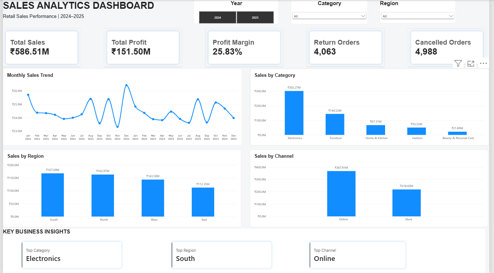

# Retail Sales Performance & Profitability Analytics

An end-to-end retail sales analytics project using Python, Pandas, NumPy, Matplotlib, Seaborn, and Power BI to analyze sales performance, profitability, and business trends.

## Project Overview

This project analyzes retail sales data to understand revenue, profit, product performance, regional trends, discounts, and sales channels. It includes data cleaning, exploratory data analysis (EDA), and an interactive Power BI dashboard to support data-driven business decisions.

## Problem Statement

Retail businesses generate large volumes of sales data, but raw transactional records alone do not provide a clear understanding of business performance. Data quality issues, including missing values, duplicate records, inconsistent categories, and discrepancies in sales calculations, can also affect the reliability of business reporting.

Without a structured analytical approach, stakeholders may find it difficult to evaluate profitability, compare product and regional performance, understand discount-related trends, and monitor sales across different channels.

This project addresses the following business questions:

- How are overall sales, profit, and profit margin performing?
- Which product categories and regions contribute to sales performance?
- How are discounts related to profitability?
- How does performance vary across sales channels?
- What data quality issues need further investigation?

## Proposed Solution

To address these challenges, this project implements an end-to-end retail analytics workflow using Python and Power BI.

- **Data Cleaning:** Identified and handled data quality issues, including duplicate records, missing values, inconsistent categories, and invalid data.
- **Exploratory Data Analysis:** Analyzed sales, profitability, discounts, product categories, regional trends, and sales channels to understand patterns in the dataset.
- **KPI Analysis:** Examined key business metrics such as total sales, total profit, and profit margin.
- **Interactive Dashboard:** Developed a Power BI dashboard with KPI cards, charts, and interactive filters to support exploration of business performance.
- **Data Quality Validation:** Documented sales calculation discrepancies requiring further investigation.

The resulting dataset, analysis, and dashboard provide a consolidated view of retail performance and help identify areas that may require further business investigation.

## Project Structure

```text
Project_1_Sales_Analytics/
├── data/
│   ├── raw/
│   │   └── Project_1_Raw_Retail_Sales.csv
│   └── processed/
│       └── sales_cleaned.csv
├── images/
│   └── sales_dashboard.png
├── notebooks/
│   ├── 01_data_understanding.ipynb
│   ├── 02_data_cleaning.ipynb
│   └── 03_eda.ipynb
├── powerbi/
│   ├── Sales_Analytics_Dashboard.pbix
│   └── Sales_Analytics_Dashboard.docx
├── src/
│   ├── __init__.py
│   ├── analysis.py
│   ├── data_cleaning.py
│   └── main.py
├── .gitignore
├── requirements.txt
└── README.md
```

## Technologies Used

* **Python** — data processing and analysis
* **Pandas and NumPy** — data cleaning and manipulation
* **Matplotlib and Seaborn** — data visualization
* **Power BI** — interactive dashboard development
* **Jupyter Notebook** — data exploration and EDA
* **Git and GitHub** — version control and project hosting

## Project Workflow

1. **Data Understanding:** Inspected the dataset structure, columns, and data quality.
2. **Data Cleaning:** Checked for duplicate records, missing values, and invalid data.
3. **Exploratory Data Analysis:** Examined sales, profitability, discounts, product categories, regions, and sales channels.
4. **Dashboard Development:** Built a Power BI dashboard with KPI cards, charts, and interactive filters.
5. **Business Insights:** Used the analysis to identify trends and areas requiring further investigation.

## Key Analysis Areas

* Total sales and profit
* Profit margin
* Product and category performance
* Regional sales trends
* Discount and profitability relationships
* Sales channel performance
* Data quality and sales calculation discrepancies

## Data Quality Note

During validation, 431 records were identified where recorded sales differed from formula-derived sales by more than ₹1. These discrepancies were documented for further investigation; their underlying cause has not been established.

## Dashboard Preview



## Installation and Setup

### 1. Clone the repository

```bash
git clone https://github.com/Kishore292006/retail-sales-performance-analytics.git
cd retail-sales-performance-analytics
```

### 2. Create a virtual environment (recommended)

```bash
python -m venv .venv
```

Activate it on Windows:

```bash
.venv\Scripts\activate
```

### 3. Install dependencies

```bash
pip install -r requirements.txt
```

### 4. Explore the analysis

Open the notebooks in Jupyter Notebook or JupyterLab to review the data understanding, cleaning, and EDA workflow.

The Power BI dashboard can be opened using Microsoft Power BI Desktop.

**Note:** Run the Python scripts from the project root and follow any file paths configured in the source code.

## Business Value

This project demonstrates how raw retail data can be cleaned, analyzed, and presented through visual dashboards to help stakeholders understand business performance and identify areas for further investigation.

The analysis supports performance monitoring and highlights patterns worth exploring further. Additional business context and validation would be needed before using the findings to make operational decisions.

## Author

**Kishore Mattapalli**  
B.Tech — Computer Science and Engineering (AI & Machine Learning)  
GD Goenka University

[GitHub Repository](https://github.com/Kishore292006/retail-sales-performance-analytics)  
[LinkedIn Profile](https://www.linkedin.com/in/mattapalli-kishore-74a134410)